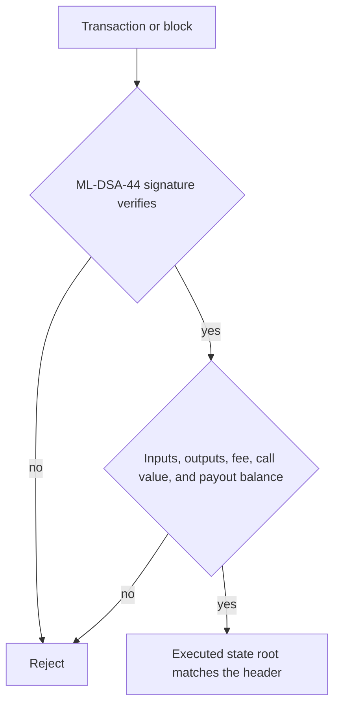

# Day-one post-quantum rules

The token is Timecoin. The ticker is TIC. The testnet at <https://github.com/Timechain-HQ/Timecoin> uses post-quantum signatures and post-quantum key encapsulation in the genesis rules. There is no classical signature path and no later upgrade that turns them on.

PQP, in this repository, means those primitives are required on the first testnet block. A quantum computer that breaks elliptic-curve signatures does not gain a second algorithm to attack inside these rules, because the rules do not contain one.

This is not a zero-knowledge proof system. Amounts are public. The proof a node checks is an ML-DSA-44 signature plus the conservation equation.

## Required on block zero

| Action | Algorithm | Standard |
| --- | --- | --- |
| Spend a note | ML-DSA-44 | FIPS 204 |
| Authorize a contract deploy or call | ML-DSA-44 | FIPS 204 |
| Sign a block | ML-DSA-44 | FIPS 204 |
| Seal a memo and a one-time spend key | ML-KEM-768 | FIPS 203 |

OpenSSL 3.5 supplies the lattice operations. The testnet does not reimplement them.

## What is proved

A failed signature rejects the transaction. A balanced transaction with a bad signature is still rejected. An unbalanced transaction with a valid signature is still rejected.

## What is not claimed

Hiding a TIC amount from validators would need an argument that conservation holds without showing the amount. This testnet does not ship that argument. Day-one safety does not wait for it: every node adds the public amounts and rejects inflation directly.

The privacy consequences of sealing the view key are in [privacy](https://github.com/Timechain-HQ/privacy).

- [Day one](docs/day-one.md) lists the objects that must verify before a block is accepted.
- [Primitives](docs/primitives.md) names the encodings and the domains.
- [Checks](docs/checks.md) is the accept path in order.
