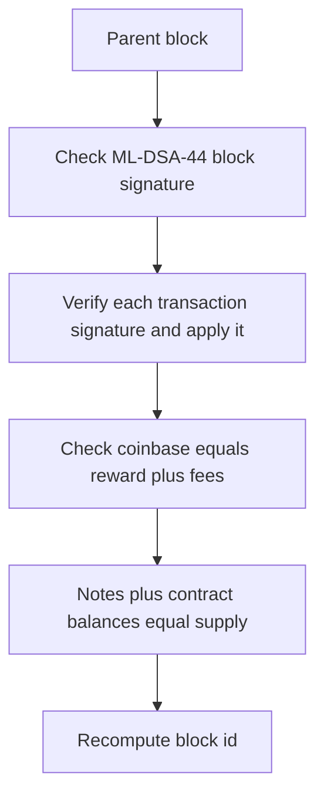

# Accept path

A block is accepted only when every step below succeeds. The order is the order in the node.

1. The parent exists and the height is the parent height plus one.
2. The slot is strictly greater than the parent slot. The target is 600 seconds. Tests may use any increasing slot.
3. The proposer signature is a valid ML-DSA-44 signature over the block signing bytes.
4. Each uncle exists, is not the parent, shares the parent's parent, and has the parent's height. At most two uncles are cited. Uncle transactions are not run.
5. Each transaction verifies its ML-DSA-44 signatures and applies to the parent state.
6. Inputs, outputs, the fee, the call value, and the payout conserve TIC.
7. The coinbase note pays exactly the 50 TIC reward plus the fees in that block.
8. Supply increases by 50 TIC and by nothing else.
9. The recomputed state root equals the header.
10. The block id is SHAKE-256 of the signing bytes and the signature. A second node with the parent can repeat this from the `TCBLK1` bytes alone.

A store file that changes a balance without changing the transactions fails step 9. The node loads blocks and executes them again. It does not trust a stored balance.
